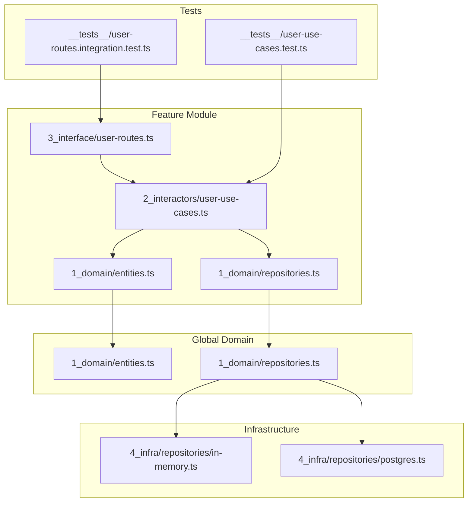

# Users Module Design Document

## Overview

This document outlines the design for a new `/users` module following the modulith pattern established in the AltiTeam project. The module will provide user management functionality including CRUD operations, profile management, and user search capabilities.

## Analysis Summary

### Existing Architecture

The project follows a **modulith architecture** with:

1. **Global Domain Layer** (`back/src/1_domain/`) - Shared entities and repository interfaces
2. **Global Infrastructure Layer** (`back/src/4_infra/`) - Repository implementations (in-memory and PostgreSQL)
3. **Feature Modules** (`back/src/features/`) - Self-contained feature modules with:
   - `1_domain/` - Feature-specific entities and repository interfaces
   - `2_interactors/` - Use cases (functional approach)
   - `__tests__/` - Co-located unit tests
   - `index.ts` - Feature composition/exports

### Existing User Infrastructure

The User entity and UserRepository interface are **already defined** in the global domain layer:

| Component | Location | Status |
|-----------|----------|--------|
| User Entity | [`back/src/1_domain/entities.ts`](back/src/1_domain/entities.ts:7) | ✅ Exists |
| UserRepository Interface | [`back/src/1_domain/repositories.ts:38-45`](back/src/1_domain/repositories.ts:38) | ✅ Exists |
| In-Memory Implementation | [`back/src/4_infra/repositories/in-memory.ts:151-177`](back/src/4_infra/repositories/in-memory.ts:151) | ✅ Exists |
| PostgreSQL Implementation | [`back/src/4_infra/repositories/postgres.ts`](back/src/4_infra/repositories/postgres.ts) | ✅ Exists |

---

## Module Directory Structure

```
back/src/features/users/
├── index.ts                          # Feature composition - exports all layers
├── 1_domain/
│   ├── entities.ts                   # User-related types and domain functions
│   └── repositories.ts               # Extended repository interfaces (if needed)
├── 2_interactors/
│   └── user-use-cases.ts             # Use case functions for user operations
├── 3_interface/
│   └── user-routes.ts                # Express routes for user endpoints
└── __tests__/
    ├── user-use-cases.test.ts        # Unit tests for use cases
    └── user-routes.integration.test.ts # Integration tests for routes
```

---

## Files to Create

### 1. `back/src/features/users/index.ts`

**Purpose:** Feature composition - exports all layers for easy importing

```typescript
/**
 * Users Feature - Feature Composition
 * Exports all layers for easy importing
 */

// Domain
export * from './1_domain/entities'
export * from './1_domain/repositories'

// Interactors
export * from './2_interactors/user-use-cases'

// Interface (routes)
export { default as userRoutes } from './3_interface/user-routes'
```

---

### 2. `back/src/features/users/1_domain/entities.ts`

**Purpose:** Define user-related types, extended interfaces, and domain functions

**Contents:**
- `UserProfile` interface - Public user profile (without sensitive data)
- `UserWithMembership` interface - User with organization membership info
- Domain functions:
  - `toPublicProfile(user: User): UserProfile` - Strip sensitive fields
  - `isValidEmail(email: string): boolean` - Email validation
  - `canUpdateUser(actorId: string, targetId: string, role: string): boolean` - Permission check

---

### 3. `back/src/features/users/1_domain/repositories.ts`

**Purpose:** Define extended repository interfaces specific to the users module

**Contents:**
- Re-export from global domain if no extensions needed
- Or define extended interfaces like `UserQueryOptions` for advanced filtering

```typescript
/**
 * Users Feature - Domain Layer
 * Layer 1: Domain - Repository Interface Extensions
 */

import type { Result } from '@/lib/result'
import type { User } from '../../1_domain/entities'

// Re-export from global domain
export type { User, CreateUserInput, UpdateUserInput, UserRepository } from '../../1_domain/repositories'

// Extended query options for user search
export interface UserQueryOptions {
  organizationId?: string
  departmentId?: string
  role?: string
  limit?: number
  offset?: number
}

// Extended repository interface (if needed)
export interface ExtendedUserRepository {
  findById(id: string): Promise<Result<User | null>>
  findByEmail(email: string): Promise<Result<User | null>>
  search(query: string, options?: UserQueryOptions): Promise<Result<User[]>>
  create(data: CreateUserInput): Promise<Result<User>>
  update(id: string, data: UpdateUserInput): Promise<Result<User>>
  delete(id: string): Promise<Result<void>>
  findByOrganization(organizationId: string): Promise<Result<User[]>>
  count(organizationId?: string): Promise<Result<number>>
}
```

---

### 4. `back/src/features/users/2_interactors/user-use-cases.ts`

**Purpose:** Use case functions following the functional approach pattern

**Use Cases to Implement:**

| Use Case | Description | Input | Output |
|----------|-------------|-------|--------|
| `getUserById` | Retrieve user by ID | `id: string` | `Result<User \| null>` |
| `getUserByEmail` | Retrieve user by email | `email: string` | `Result<User \| null>` |
| `searchUsers` | Search users by query | `query: string, options?` | `Result<User[]>` |
| `createUser` | Create new user | `CreateUserInput` | `Result<User>` |
| `updateUser` | Update existing user | `id, UpdateUserInput` | `Result<User>` |
| `deleteUser` | Delete user | `id: string` | `Result<void>` |
| `getUserProfile` | Get public profile | `id: string` | `Result<UserProfile>` |
| `updateProfile` | Update own profile | `userId, UpdateUserInput` | `Result<User>` |
| `getUsersByOrganization` | Get org members | `organizationId: string` | `Result<User[]>` |

**Pattern (following tasks module):**

```typescript
/**
 * Users Feature - Interactors Layer
 * Layer 2: Interactors - Use Cases (Functional Approach)
 */

import type { UserRepository, CreateUserInput, UpdateUserInput } from '../1_domain/repositories'
import type { User } from '../1_domain/entities'
import type { Result } from '@/lib/result'
import { success, failure, isSuccess } from '@/lib/result'

// Dependencies type
type Dependencies = {
  userRepository: UserRepository
  generateId: () => string
  getCurrentTime: () => Date
}

// Get User By ID Use Case
export const getUserById = (deps: Dependencies) => {
  return async (id: string): Promise<Result<User | null>> => {
    try {
      const user = await deps.userRepository.findById(id)
      return user
    } catch (error) {
      return failure(error as Error)
    }
  }
}

// Create User Use Case
export const createUser = (deps: Dependencies) => {
  return async (input: CreateUserInput): Promise<Result<User>> => {
    try {
      // Validation
      if (!input.email || input.email.trim().length === 0) {
        return failure(new Error('Email is required'))
      }

      // Email format validation
      const emailRegex = /^[^\s@]+@[^\s@]+\.[^\s@]+$/
      if (!emailRegex.test(input.email)) {
        return failure(new Error('Invalid email format'))
      }

      // Check for existing user
      const existing = await deps.userRepository.findByEmail(input.email)
      if (isSuccess(existing) && existing.data) {
        return failure(new Error('User with this email already exists'))
      }

      // Create user
      const user = await deps.userRepository.create(input)
      return user
    } catch (error) {
      return failure(error as Error)
    }
  }
}

// ... additional use cases

// Factory function to create user dependencies
export const createUserDependencies = (
  userRepository: UserRepository
): Dependencies => ({
  userRepository,
  generateId: () => `user-${Math.random().toString(36).substr(2, 9)}`,
  getCurrentTime: () => new Date(),
})
```

---

### 5. `back/src/features/users/3_interface/user-routes.ts`

**Purpose:** Express routes for user API endpoints

**Endpoints:**

| Method | Endpoint | Description | Auth Required |
|--------|----------|-------------|---------------|
| GET | `/api/users/:id` | Get user by ID | Yes |
| GET | `/api/users/email/:email` | Get user by email | Yes |
| GET | `/api/users/search` | Search users | Yes |
| POST | `/api/users` | Create user | Admin |
| PUT | `/api/users/:id` | Update user | Owner/Admin |
| DELETE | `/api/users/:id` | Delete user | Admin |
| GET | `/api/users/profile` | Get own profile | Yes |
| PUT | `/api/users/profile` | Update own profile | Yes |
| GET | `/api/users/organization/:orgId` | Get org members | Yes |

**Pattern:**

```typescript
/**
 * Users Feature - Interface Layer
 * Layer 3: Interface - Express Routes
 */

import { Router, Request, Response } from 'express'
import type { UserRepository } from '../1_domain/repositories'
import { getUserById, createUser, updateUser, deleteUser, createUserDependencies } from '../2_interactors/user-use-cases'

export const createUserRoutes = (userRepository: UserRepository) => {
  const router = Router()
  const deps = createUserDependencies(userRepository)

  // GET /api/users/:id
  router.get('/:id', async (req: Request, res: Response) => {
    const result = await getUserById(deps)(req.params.id)
    if (isSuccess(result) && result.data) {
      res.json({ user: toPublicProfile(result.data) })
    } else {
      res.status(404).json({ error: 'User not found' })
    }
  })

  // ... additional routes

  return router
}

export default createUserRoutes
```

---

### 6. `back/src/features/users/__tests__/user-use-cases.test.ts`

**Purpose:** Unit tests for use case functions

**Test Cases:**
- Email validation (empty, invalid format, valid)
- User creation (success, duplicate email)
- User update (not found, success)
- User deletion (not found, success)
- Search functionality

---

### 7. `back/src/features/users/__tests__/user-routes.integration.test.ts`

**Purpose:** Integration tests for API routes

**Test Cases:**
- GET `/api/users/:id` returns user
- GET `/api/users/:id` returns 404 for non-existent
- POST `/api/users` creates user
- PUT `/api/users/:id` updates user
- DELETE `/api/users/:id` deletes user

---

## Repository Interface Methods

The existing `UserRepository` interface in [`back/src/1_domain/repositories.ts:38-45`](back/src/1_domain/repositories.ts:38) already defines:

```typescript
export interface UserRepository {
  findById(id: string): Promise<Result<User | null>>
  findByEmail(email: string): Promise<Result<User | null>>
  search(query: string, organizationId?: string, limit?: number): Promise<Result<User[]>>
  create(data: CreateUserInput): Promise<Result<User>>
  update(id: string, data: UpdateUserInput): Promise<Result<User>>
  delete(id: string): Promise<Result<void>>
}
```

### Recommended Additions

For the users module, consider adding these methods to support common use cases:

| Method | Purpose | Signature |
|--------|---------|-----------|
| `findByOrganization` | Get all users in an organization | `(organizationId: string) => Promise<Result<User[]>>` |
| `count` | Count users (for pagination) | `(organizationId?: string) => Promise<Result<number>>` |
| `updateLastLogin` | Track user activity | `(id: string) => Promise<Result<void>>` |

---

## Integration Points

### 1. Server Registration

Update [`back/src/server.ts`](back/src/server.ts) to mount user routes:

```typescript
// Import
import { userRoutes } from './features/users/index.js'

// Mount routes (add after existing routes)
app.use('/api/users', userRoutes(userRepos))
```

### 2. Existing Repository Integration

The users module should use the existing `repos.users` from the global `Repositories` container:

```typescript
import { getRepositories } from '@/lib/repositories'
const repos = getRepositories()
const userDeps = createUserDependencies(repos.users)
```

### 3. Auth Module Integration

The existing auth routes in [`back/src/server.ts:106-150`](back/src/server.ts:106) handle:
- `/api/auth/register` - User registration
- `/api/auth/login` - User login

The users module should **not** duplicate these endpoints. Instead, it should focus on:
- Profile management
- User administration (admin operations)
- User search and discovery

### 4. TeamMember Integration

Users are associated with organizations through `TeamMember` entities. Consider:

```typescript
// In user-use-cases.ts
export const getUserWithMembership = (deps: Dependencies & { teamMemberRepo: TeamMemberRepository }) => {
  return async (userId: string, organizationId: string): Promise<Result<UserWithMembership>> => {
    // Implementation
  }
}
```

---

## Architecture Diagram



---

## Implementation Checklist

- [ ] Create `back/src/features/users/` directory structure
- [ ] Implement `1_domain/entities.ts` with UserProfile type and domain functions
- [ ] Implement `1_domain/repositories.ts` with extended interfaces
- [ ] Implement `2_interactors/user-use-cases.ts` with all use cases
- [ ] Implement `3_interface/user-routes.ts` with Express routes
- [ ] Create `__tests__/user-use-cases.test.ts` with unit tests
- [ ] Create `__tests__/user-routes.integration.test.ts` with integration tests
- [ ] Update `back/src/server.ts` to mount user routes
- [ ] Run `npx tsc --noEmit` to verify TypeScript
- [ ] Run `pnpm test` to verify tests pass
- [ ] Run `pnpm lint` to verify code style

---

## Notes

1. **No Database Changes Required** - The User entity and repository implementations already exist
2. **Functional Approach** - Use cases follow the functional pattern from the tasks module
3. **Result Type** - All operations return `Result<T, E>` for type-safe error handling
4. **Co-located Tests** - Tests are placed in `__tests__` within the feature module
5. **Clean Architecture** - Dependencies flow inward (interface → interactors → domain)
